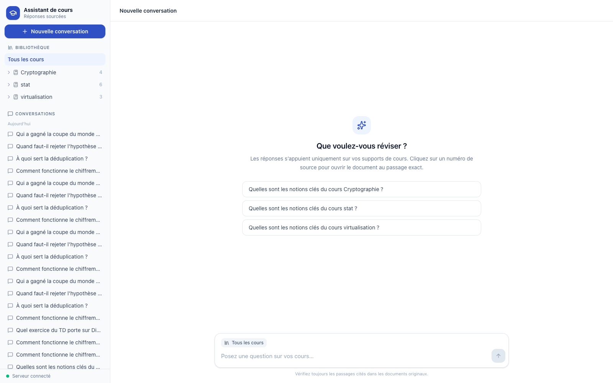
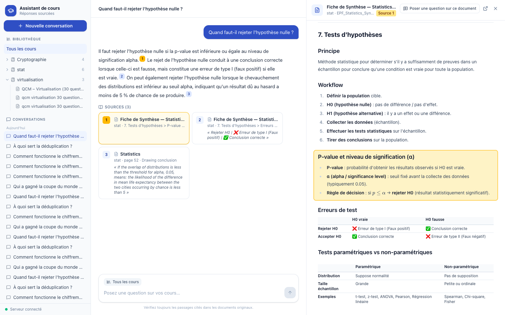

# Assistant de cours — a course RAG with verifiable answers

A question-answering assistant for university courses, built for the EPF Generative AI course.

## Overview

Students who revise from lecture slides, exercise sheets and summary sheets often ask a general-purpose chatbot instead. Such a chatbot may answer from outside the course or invent facts, and gives no way to check where an answer came from.

This project answers questions **only from the student's own course material**, using retrieval-augmented generation (RAG). Every sentence of an answer cites its sources. Clicking a citation opens the original document **at the exact lines** the sentence relies on. When the material does not contain the answer, the assistant says so instead of guessing.

Main use case: a student imports their courses (PDF, Markdown, text or Excel files), asks questions in French or English through a French web interface, and checks each answer against the highlighted passage.





**Presentation:** the project slides are on [Canva](https://canva.link/4g1q5ajhto9na79).

## Features

- **Hybrid search with reranking.** A vector search (meaning) and a keyword search (exact terms such as "vMotion", "ECB" or "Kerckhoffs") propose candidate passages; a reranker model reads the question with each candidate and re-sorts them. The 8 best passages go to the language model, which may use nothing else.
- **Answers grounded in the course only.** When even the best candidate is judged irrelevant, the assistant replies "Je n'ai pas trouvé cette information dans les supports de cours" without calling the language model.
- **Verified, line-exact citations.** The model must return each sentence with its sources and a word-for-word quote from each. A sentence that cites no valid source is not shown. The server checks every quote against the source text and maps it to its exact lines; if a quote cannot be found, the whole excerpt is highlighted instead.
- **Highlighted sources in a built-in viewer.** PDF pages (with highlight boxes over the cited lines), Markdown and text sheets (with formulas rendered), and spreadsheets (with cited rows highlighted).
- **Scoped questions.** Ask across all courses, one subject, one course, or a single document.
- **Conversations.** Saved automatically; they can be renamed and deleted. Follow-up questions ("Et pour AES ?") are rewritten into standalone questions using the conversation history.
- **Streamed answers.** Sentences appear as they are validated.
- **Course formats.** Beamer and PowerPoint slides exported to PDF, exercise sheets, multiple-choice sheets (the highlighted answers are read from the PDF), Markdown with LaTeX formulas, plain text and Excel workbooks (`.xlsx`).
- **Incremental import.** Unchanged files are skipped; a changed file replaces its previous version.
- **Local embeddings, free-tier answers.** The embedding model runs on the user's machine (Apple GPU, NVIDIA GPU or CPU). Answers are written by Google Gemini or by models served by Groq, with automatic fallback to the next model when one is overloaded.

## Architecture

```text
Import:   course files ─► parse (layout-aware) ─► chunks with their source lines ─► local embeddings ─► PostgreSQL + pgvector
Question: rewrite follow-up ─► vector search + keyword search in scope ─► rerank ─► relevance cutoff ─► 8 excerpts ─► LLM (claims + verbatim quotes)
          ─► verify quotes ─► stream the answer ─► citation opens the document with the lines highlighted
```

| Component | Location | Responsibility |
|---|---|---|
| Web interface | `frontend/` | Library and conversations, chat, document viewer. Talks to the API over HTTP and reads the streamed answer. |
| API | `backend/app/main.py` | HTTP endpoints for the library, documents, conversations and answers. Applies database migrations on startup. |
| Ingestion | `backend/app/ingest.py`, `ingestion.py`, `pdf_parsing.py`, `text_parsing.py` | Finds course files, parses them, splits them into chunks that remember their source lines, embeds and stores them. |
| Retrieval and answering | `backend/app/answering.py`, `locating.py` | Rewrites follow-ups, runs the hybrid search and reranking in scope, builds the prompt, validates the model's claims and quotes, and maps quotes to exact lines. |
| Providers | `backend/app/providers/` | Clients for the embedding and reranking service; Gemini and Groq answer providers; offline test doubles. |
| Model service | `embeddings/service.py` | Small HTTP service that runs the embedding model and the reranker. Runs natively by default so it can use the GPU, or in Docker on the CPU. |
| Database | PostgreSQL + pgvector (`compose.yaml`) | Documents, chunks, vectors, a French full-text index, source positions and conversations. |

**Data flow for a question:**
1. The interface sends the question, the conversation and the scope to `POST /api/v1/answers/stream`.
2. A follow-up question is first rewritten into a standalone question.
3. Two searches run within the scope: the 20 closest chunks by vector similarity, and the 20 best keyword matches (PostgreSQL full-text search in French).
4. The reranker scores every candidate against the question. The final order fuses the vector ranking and the reranker ranking (reciprocal rank fusion).
5. If even the best candidate scores under the reranker's relevance cutoff, the assistant refuses without calling the language model. Otherwise the 8 best passages are kept.
6. The excerpts are sent to the language model, which returns sentences ("claims"), each with source numbers and verbatim quotes.
7. Sentences without a valid source are dropped. Each quote is verified against its excerpt and located in the original file.
8. The sentences stream back to the interface as newline-delimited JSON, followed by their citations.

[docs/ARCHITECTURE.md](docs/ARCHITECTURE.md) explains each design decision in detail. It covers the parsing rules, the chunk size, the embedding model choice (benchmarked on the course material), the hybrid search and reranking recipe (also measured), PostgreSQL instead of a dedicated vector database, the full LLM prompt, the API, and the measured thresholds.

## Technology stack

| Area | Technology | Role |
|---|---|---|
| Backend | Python 3.12, FastAPI, SQLAlchemy 2, Alembic, Pydantic Settings | API, data access, migrations, configuration |
| Parsing | PyMuPDF, openpyxl | PDF layout and text extraction; Excel workbooks |
| Embeddings | Qwen3-Embedding-0.6B via sentence-transformers and PyTorch | 1024-dimension vectors for passages and questions |
| Vector database | PostgreSQL 16 with pgvector 0.8.6 (HNSW index, cosine distance) | Storage and similarity search |
| Keyword search | PostgreSQL full-text search (`tsvector`, French stemming, GIN index) | Exact terms, acronyms and names |
| Reranking | BAAI/bge-reranker-v2-m3 (multilingual cross-encoder) via sentence-transformers | Re-sorts the candidates and decides whether anything is relevant |
| Answer generation | Google Gemini (`google-genai`, default `gemini-3.8-flash` with fallbacks) or Groq; temperature 0.2 | Writes the answer from the retrieved excerpts |
| Quote verification | rapidfuzz | Matches the model's quotes to the source text |
| Frontend | Next.js 15, React 19, TypeScript, Tailwind CSS, react-pdf (pdf.js), KaTeX | French web interface and document viewer |
| Tooling | Docker Compose, uv, pytest, ruff, mypy, Vitest, ESLint | Running, dependencies, tests and static checks |

## Prerequisites

- **Docker Desktop** (or Docker Engine with Compose v2), to run the database, API and web interface. Docker must be able to pull `pgvector/pgvector`, `python` and `node` images from Docker Hub.
- **[uv](https://docs.astral.sh/uv/)** (`brew install uv` on macOS). It runs the embedding model natively and the ingestion, evaluation and test commands, and installs Python 3.12 automatically.
- **An API key** for the answer model: a [Gemini API key](https://aistudio.google.com/apikey) (free tier) or a [Groq API key](https://console.groq.com/keys).
- **About 3.5 GB** of disk space and a network connection for the first start (PyTorch, the embedding model and the reranker are downloaded once).
- **Node.js 22 or later and npm**, only to run the frontend tests and checks (the interface itself is built inside Docker).

## Installation and configuration

1. **Clone the repository.**

   ```sh
   git clone https://github.com/YoussefAG1337/RAG_epf.git
   cd RAG_epf
   ```

2. **Create the configuration file.** All settings live in `.env` at the repository root; `.env` is ignored by Git, so keys never leave your machine.

   ```sh
   cp .env.example .env
   ```

   Then edit `.env`:
   - For Gemini (the default), set `GEMINI_API_KEY`.
   - For Groq, set `ANSWER_PROVIDER=groq` and `GROQ_API_KEY`, plus the models suggested in the comment in `.env.example`.
   - If another PostgreSQL already uses port 5432 on your machine, set `DATABASE_PORT` to a free port (for example `5433`).

   The most useful settings:

   | Setting | Meaning |
   |---|---|
   | `ANSWER_PROVIDER` | `gemini` (default) or `groq` |
   | `GEMINI_API_KEY`, `GROQ_API_KEY` | Key for the answer provider |
   | `PDF_SOURCE_DIR` | Folder with the course material, relative to the repository root (default `data/course-pdfs`) |
   | `DATABASE_PORT` | Host port for PostgreSQL (default 5432) |
   | `ANSWER_MODEL`, `ANSWER_FALLBACK_MODELS` | Answer model, then fallbacks tried in order when one is overloaded or rate limited |
   | `ANSWER_TEMPERATURE` | Answer model temperature, 0 to 2 (default 0.2) |
   | `RERANK_MINIMUM_SCORE` | Reranker relevance cutoff (empty: the measured default, 0.005) |
   | `EVIDENCE_MINIMUM_SCORE` | Cosine relevance cutoff, used when reranking is off (empty: the measured default, 0.40) |
   | `RERANK_PROVIDER` | `none` turns reranking off (vector and keyword rankings are then fused directly) |
   | `RETRIEVAL_LIMIT` | Number of excerpts given to the model (default 8) |
   | `API_HOST_PORT`, `WEB_HOST_PORT`, `EMBEDDING_PORT` | Host ports of the API (8000), interface (3000) and embedding service (8081) |

   Commands find `.env` from any directory.

3. **Add course material.** Put files in the `PDF_SOURCE_DIR` folder, one folder per course, optionally grouped by subject. This folder is ignored by Git, so course material is never committed.

   ```text
   data/course-pdfs/
     Cryptographie/          (course)
       slides.pdf
       TD/TD1.pdf
     Informatique/           (subject)
       Algorithmique/        (course)
         cours_1.pdf
   ```

   Supported formats: PDF, Markdown, plain text and Excel (`.xlsx`). Export PowerPoint and Word files to PDF first.

## Running the application

**Start everything:**

```sh
./start.sh
```

The script starts the embedding model natively (on the GPU when one is available) and waits until it is loaded. It then starts PostgreSQL, the API and the web interface with `docker compose up --build -d --wait`. The first start downloads PyTorch and the model; later starts take seconds.

On a machine without a usable GPU or without `uv`, run everything in Docker on the CPU (imports are then about 10 times slower):

```sh
EMBEDDINGS_IN_DOCKER=1 ./start.sh
```

**Import the courses** (with the services running):

```sh
uv run --project backend python -m app.ingest --all --dry-run   # preview what will be indexed, without storing anything
uv run --project backend python -m app.ingest --all             # import; unchanged files are skipped
```

With `--all`, `--course-id <course>` or `--subject <subject>` limits the import to one course or subject. `--file <path>` (relative to `PDF_SOURCE_DIR`) imports a single file. New files are available immediately, without a restart.

**Open the application:**
- Interface: <http://localhost:3000>
- API: <http://localhost:8000> (interactive documentation at <http://localhost:8000/docs>)
- Service status: `docker compose ps`; embedding service log: `.run/embeddings.log`

**Stop everything** (the database is kept in a Docker volume):

```sh
./stop.sh
```

## Usage and demonstration

The interface is in French and has three panes:
- **Bibliothèque** and conversations on the left.
- The chat in the centre.
- The document viewer on the right, opened from a citation or from the library.

A typical demonstration with a cryptography course imported:

1. Open <http://localhost:3000>. The library lists the imported subjects and courses.
2. Leave **Tous les cours** selected and ask *"Comment fonctionne RSA ?"*. The answer streams in sentence by sentence, each ending with numbered source markers.
3. Hover a source number to read the verified quote. Click it, or the source card below the answer, to open the document at the highlighted lines.
4. Ask a follow-up: *"Et pour AES ?"*. **Recherche effectuée** shows how the question was understood using the conversation.
5. Select one course in the library to narrow the scope. The current scope is shown above the question box; `✕` returns to all courses.
6. Open a document from the library and click **Poser une question sur ce document** to ask about that document only.
7. Ask something the courses do not cover, for example *"Qui a gagné la coupe du monde 2018 ?"*. The assistant replies that it did not find the information in the course material.
8. Reload the page. The address bar keeps the open conversation and document, and the conversation list keeps every exchange.

## Testing and validation

**Backend** (from the `backend/` folder, where the tools read their configuration in `pyproject.toml`):

```sh
cd backend
uv run --extra dev pytest                  # 142 tests
uv run --extra dev ruff check . ../embeddings
uv run --extra dev ruff format --check . ../embeddings
uv run --extra dev mypy app tests          # strict mode
```

The tests cover:
- PDF, Markdown and Excel parsing, chunking and source locating.
- Prompt construction, the relevance cutoff, quote verification and streamed answering.
- The API, the providers and the configuration.

Five of the tests are integration tests that need PostgreSQL. They create and drop a throwaway `course_rag_test` database, so your data is never touched. They connect to `TEST_DATABASE_PORT` (default 5433; set it to your `DATABASE_PORT`) and are skipped when no server is reachable.

**Frontend** (24 tests: stream contract validation, chat state, math rendering and the main interface flows):

```sh
cd frontend
npm install
npm test -- --run
npm run lint
npm run typecheck
```

**End-to-end check** of the running application in a real Chromium-based browser (Chrome, Brave, Edge…); set `BROWSER_PATH` if the browser is not found:

```sh
cd frontend && npm run e2e
```

**Retrieval and answer quality**, on the questions with known sources in `backend/eval/questions.json` (30 paraphrase questions and 12 exact-term questions such as "DRS" or "mode ECB") plus 5 off-topic questions:

```sh
uv run --project backend python -m app.evaluate             # retrieval only
uv run --project backend python -m app.evaluate --answers   # also generates answers (uses the API quota)
```

Results on the EPF course material (Cryptographie, Statistiques and Virtualisation: 13 files, 364 chunks):

| Measure | Result |
|---|---|
| Right passage ranked first (paraphrases) | 83 % (25/30) |
| Right passage among the 3 best (paraphrases) | 93 % (28/30) |
| Right passage among the 8 excerpts given to the model (paraphrases) | 100 % (30/30) |
| Mean reciprocal rank (paraphrases) | 0.893 |
| Exact term ranked first | 100 % (12/12); vector search alone: 11/12 |
| Answerable questions answered | 28 / 30 |
| Off-topic questions refused | 5 / 5 |
| Citations whose quote was verified and highlighted exactly | 41 / 41 |

The retrieval figures are deterministic. The answer figures come from an earlier `--answers` run with Gemini, on the 30 paraphrase questions and before hybrid search; answers vary slightly between runs. A full `--answers` run can also exhaust the Gemini free tier's per-minute quota, and the questions affected show up as errors.

## Limitations and future improvements

**Current limitations:**
- **Images are not read.** Diagram-only slides contribute only their title, and scanned PDFs need OCR first.
- **Excel files** are indexed by their text rows (hypotheses, rules, labelled results), not their numerical data.
- **Deleted files stay indexed.** Removing a course file does not remove its passages: they can still be cited, and the viewer link then fails. Changed files are replaced correctly.
- **Single user.** There is no authentication; the application is meant for one user on one machine.
- **Free-tier dependency.** Answer time depends on the provider: typically 7–15 s, and up to about a minute when a model stalls (after 30 s without a response the next model takes over). When every model is busy, the interface asks to retry in a minute.
- **Small evaluation set.** 30 questions give a useful signal but not statistical certainty. The best off-topic relevance score (0.451) is also slightly above the lowest correct-passage score (0.447), so the cutoff alone does not separate them; the model's refusal handles that case.

**Possible future improvements** (not implemented):
- Remove documents whose file was deleted when importing.
- Hybrid search (keyword search with vectors) for exact terms such as course codes and formula names.
- Describe diagrams at import time with a vision model, and add OCR for scanned PDFs.
- Grow the evaluation set, and add an answer-relevance score next to the existing quote verification.
- Run the tests and checks in continuous integration.
- Authentication for several users.

## Troubleshooting

| Symptom | Fix |
|---|---|
| "Serveur injoignable" in the interface | The API is starting or stopped; the page retries by itself. `docker compose ps` shows service health. |
| Import or answers fail with `EmbeddingServiceError` | Run `./start.sh` (it waits until the model is loaded); see `.run/embeddings.log`. |
| Port already in use | Another program uses 5432, 8000, 3000 or 8081: change `DATABASE_PORT`, `API_HOST_PORT`, `WEB_HOST_PORT` or `EMBEDDING_PORT` in `.env` (`EMBEDDING_URL` must use the same port as `EMBEDDING_PORT`). |
| "Le service de rédaction des réponses est saturé" | The answer provider's free tier is busy or its quota is used up; retry after a minute. |
| Docker cannot pull an image (`401 Unauthorized`) | Sign in to Docker Hub with `docker login`, then run `./start.sh` again. |

## Repository structure

```text
backend/              FastAPI application (Python)
  app/                  API, ingestion, parsing, retrieval, answering, conversations, evaluation
  app/providers/        embedding client, Gemini and Groq answer providers, offline test doubles
  alembic/              database migrations
  eval/questions.json   evaluation questions with their expected sources
  tests/                unit and integration tests
embeddings/           embedding service (native or Docker)
frontend/             Next.js interface (French)
  app/, components/     pages, library sidebar, chat, document viewer
  lib/                  API client and chat state
  e2e/                  end-to-end browser check
docs/                 ARCHITECTURE.md and screenshots
compose.yaml          database, API, web interface (and optional embedding container)
start.sh, stop.sh     start and stop everything
.env.example          configuration template
```

## Team and Contributions

| Member | Area of responsibility |
|---|---|
| **Hedi Brahmi** | **AI/RAG and system architecture:** the retrieval-augmented generation pipeline (embedding model, chunking, retrieval and relevance cutoff), the integration of the Gemini and Groq models, the prompt and quote verification, the overall architecture, and its documentation in `docs/ARCHITECTURE.md`. |
| **Seifeddine Chargui** | **Backend and data processing:** the FastAPI endpoints and server-side logic, document parsing and ingestion, the database schema and migrations, configuration, and the integration between the API, the database and the embedding service, with the corresponding backend tests. |
| **Youssef Agrebaoui** | **Frontend and user experience:** the Next.js interface (library, chat and document viewer), the handling of the streamed answers and citation highlighting, the user workflow, and the frontend and end-to-end tests. |

This table shows how responsibilities are divided across the project and its presentation. It is not a record of who wrote each commit.

## Acknowledgments and references

- Course material from the EPF courses Cryptographie, Statistiques and Virtualisation, used locally for testing and evaluation (not included in the repository).
- [Qwen3-Embedding](https://huggingface.co/Qwen/Qwen3-Embedding-0.6B) (Qwen team), [sentence-transformers](https://www.sbert.net/), [pgvector](https://github.com/pgvector/pgvector), [PyMuPDF](https://pymupdf.readthedocs.io/), [FastAPI](https://fastapi.tiangolo.com/), [Next.js](https://nextjs.org/) and [react-pdf](https://github.com/wojtekmaj/react-pdf).
- Answer generation through the [Google Gemini API](https://ai.google.dev/) and [Groq](https://groq.com/).
